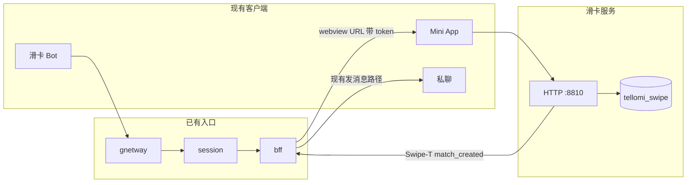

# 滑动匹配服务设计

状态：只设计，没有实现。本文不新增迁移、进程、配置文件、TL 构造或客户端补丁。

Tellomi 是面向中国大陆的陌生人交友产品，账号与聊天跑在 Teamgram 上，iOS / Android 是改牌后的 Telegram 客户端。滑动匹配是聊天之外的独立服务。候选、喜欢、跳过、匹配、举报都落在自己的库里，不进 `users`、`messages`、`dialogs`。

本文对齐：

- [架构扩展](../architecture-extension.md)：独立进程、独立库、独立 Kafka 主题，以及 HTTP 与 MTProto 两条缝。
- [Premium](../premium.md)：会员是服务器配置，功能用 token 开关。
- [硬规则](../TELLOMI_RULES.md)：客户端改动最小、可加、隔离，并写入各端 `UPSTREAM_PATCHES`。补 API 时对照已有 TL，不在聊天 schema 上堆列。

## 1. 结论

v1 用一个 Tellomi 官方 Bot 打开已有的 Telegram Mini App（Web App）。客户端不增加 TL，也不做原生滑卡屏。

用户从 Bot 的菜单打开 Web App。服务端走已经实现的 `messages.requestWebView` / `messages.requestMainWebView` / `messages.requestAppWebView`。这些方法今天汇合到 `chatbox.OpenWebView`，会记下 `webSession`（用户 id、Bot id、过期时间、URL）。只对滑卡 Bot，在返回的 URL 上追加短时 token。Mini App 拿这个 token 调滑卡自己的 HTTP。滑卡进程用 token 取出 `user_id`，再请 authsession 确认这个登录仍然有效。没有第二套账号，也没有滑卡专用密码。

互相喜欢之后，由 bff 消费匹配事件，调用现有发消息路径写一条私聊服务消息。会话列表里因此出现与对方的私聊。滑卡服务不写消息表，也不自己发 `Sync-T`。

`swipe.*` TL 和双端隔离原生屏留到 Mini App 不够用的时候。Super Like 留配置开关，v1 对用户关闭，打开后走 Premium token。

## 2. 产品流程



### 2.1 进入

大陆账号仍按硬规则默认只收 +86。滑卡不另做注册。

用户第一次打开 Mini App，先看到单独的滑卡说明和同意。同意之后才能填写只用于匹配的资料。未同意的账号不会进候选。

可以进卡组的条件同时满足：

- 聊天账号存在，未删除，不是 Bot，未被 `restricted`。
- 已同意滑卡用途。
- 年龄满 18 周岁。
- 性别、年龄偏好、至少一张审核通过的照片已齐。
- 资料状态是「公开」。用户可自己暂停。
- 实名开关打开时，核验状态是已通过。公网阶段默认打开，见第 9 节。
- 不在封禁中，也没有因举报积压被自动暂停。

昵称默认读 biz 里的 `first_name`。用户可以另设一个只出现在卡片上的昵称。卡片照片来自滑卡相册，不默认使用聊天头像 `users.photo_id`。手机号、邮箱、用户名不出现在卡片上。

### 2.2 卡片、喜欢、跳过

卡组一次给一小叠（建议 10 张）。每张卡片展示：卡片昵称、年龄（周岁）、省级属地、审核通过的照片、审核通过的简介。城市只参与排序，是否展示到「市」由 owner 定，见开放问题。

每张卡片两个动作：

| 动作 | 含义 | 额度 |
| --- | --- | --- |
| 喜欢 | 愿意和对方聊天 | 计入每日喜欢次数 |
| 跳过 | 今天不再看到对方 | 不计入喜欢次数；另有较高的每日上限，用来挡脚本刷卡 |

同一张卡重复提交，返回第一次的结果，不重复扣额度。跳过或喜欢之后，对方不再进入自己的卡组。对方看不到「谁跳过了我」。

喜欢在互相喜欢之前只有自己和服务器知道。卡片接口不返回「对方已经喜欢你」。排序可以利用这个信号，见第 6 节，但卡片外观不变。

### 2.3 互相喜欢，打开私聊

双方都喜欢，记一条匹配。匹配只产生一次：库里对 `(较小 user_id, 较大 user_id)` 做唯一约束，只有插入成功的那一次发布 `match_created`。

bff 消费这条事件，调用现有发消息路径，在双方的私聊里写一条服务消息，动作为已有构造 `messageActionCustomAction`，文案固定，例如「你们互相喜欢，可以开始聊天」。这条消息走现有 outbox / inbox，会话行由 msg 创建，更新经 bff 发到 `Sync-T`。滑卡服务不插入 `dialogs` 或 `messages`。

Mini App 的匹配结果只说明「已开始聊天，回到会话列表即可看到」。响应里没有对方的数字 `user_id`。v1 不发 `tg://` 深链。

产品要求这条私聊出现在主会话列表。若现有发消息路径会把非联系人归档，或受「非联系人需 Premium 才能发消息」（`new_noncontact_peers_require_premium`）影响而送不达，bff 先用已有联系人接口把双方加为联系人，再发服务消息。是否互加联系人请 owner 确认。

解除匹配只影响滑卡：双方不再互相推荐。已经产生的私聊怎么处理见开放问题。建议默认保留聊天记录，由用户自己在聊天里删除。

### 2.4 每日额度

按 Asia/Shanghai 自然日计算。建议值，上线前由 owner 改配置：

| 项 | 建议 |
| --- | --- |
| 每日喜欢 | 20 |
| 会员更高喜欢额度 | 80，绑在 token `swipe_extra_likes` 上 |
| 每日跳过上限 | 200 |
| 每批候选 | 10 |
| Super Like | v1 关闭；开关打开后建议每日 1 次免费或 5 次会员，见第 11 节 |

额度存在 Redis，键前缀 `swipe:`，带过期时间。Redis 丢了就按当天的 `swipe_decisions` 重算。生产 Redis 禁止 `FLUSHALL`，这是运维规则，键前缀不能代替它。

看卡片不扣喜欢次数。额度在提交喜欢时扣。

### 2.5 Super Like（以后的 Premium 开关）

v1 数据模型和决策接口预留 `super_like`，产品开关默认关。关闭时接口拒绝这个动作，客户端不展示入口。

打开之后同时满足两件事才可用：

1. 产品开关 `TELLOMI_SWIPE_SUPER_LIKE=true`。
2. Premium 策略允许 token `swipe_super_like`（有效会员，或该 token 被标成免费，或 `TELLOMI_PREMIUM_EVERYONE=true`）。

对方会在下一次卡组里更靠前地看到这张卡，卡片上可以标出「Super Like」。仍然要双方喜欢才打开私聊。Super Like 不能绕过拉黑、年龄、审核和实名。

撤回上一次滑动、付费墙、应用内购买都不在本文范围。购买入口仍由 `TELLOMI_PREMIUM_PURCHASE_BLOCKED` 控制。

## 3. 服务边界

滑卡是单独进程，注册 etcd key `service.swipe`。占位端口与 [架构扩展](../architecture-extension.md) 一致：HTTP `8810`，gRPC `127.0.0.1:20810`。数据库 `tellomi_swipe`。Kafka 主题 `Swipe-T`。`TELLOMI_SWIPE_MYSQL` 为空时进程不启动。

| 谁 | 做什么 |
| --- | --- |
| 滑卡服务 | 资料、照片引用、偏好、决策、匹配、滑卡拉黑、滑卡举报、实名状态、审核状态、额度、排序 |
| biz | `user_id` 的来源。读昵称、删除标记、封禁、`user.isBlockedByUser`。滑卡不插入用户行 |
| authsession | 确认 token 对应的用户仍登录。滑卡不解析 MTProto，不查 auth key |
| dfs / MinIO | 照片字节。滑卡只存 file id。实现时滑卡配置要带上与动态服务草稿相同的 `DfsClient`；架构笔记里的 `swipe.yaml` 草稿还没有这一段，实现时补上，不把照片列进聊天表 |
| bff | 给滑卡 Bot 的 WebView URL 追加 token；消费 `Swipe-T` 上的匹配与拉黑；调现有发消息与 `user.blockPeer`；只有 bff 把更新写入 `Sync-T` |
| 客户端 | v1 只使用上游已有的 Bot 与 WebView。不改登录、不改 DC、不改 `messages.getDialogs` |

`Swipe-T` 与 `Sync-T`、`Inbox-T` 分开，滑卡消费变慢不能堵住聊天投递。主题名可以按环境用 `TELLOMI_SWIPE_TOPIC` 覆盖，默认 `Swipe-T`。

滑卡服务发布的事件建议只保留这些：

| type | 何时 | 谁消费 |
| --- | --- | --- |
| `match_created` | 新匹配插入成功 | bff，幂等于 `match_id` |
| `block` | 滑卡内拉黑 | bff，调已有 `user.blockPeer` |
| `unmatch` | 解除匹配 | bff，仅当 owner 决定要改私聊时才动作；默认只记日志 |

喜欢和跳过不进 Kafka。它们只在 `tellomi_swipe` 里。

## 4. 数据模型

库名 `tellomi_swipe`，字符集 `utf8mb4`。`user_id` 是 biz 的用户 id，本库不创建用户。下面是逻辑模型，不是迁移脚本。

### 4.1 `swipe_profiles`

一人一行。

| 列 | 说明 |
| --- | --- |
| `user_id` | 主键 |
| `consent_at` | 同意滑卡用途的时间。空表示未同意 |
| `display_name` | 可选的卡片昵称。空则读 biz |
| `gender` | `male` / `female` / `other`。v1 进卡组前必填 |
| `birth_date` | 日期。用于算周岁。不从聊天生日隐私里偷读出来展示 |
| `bio` | 待审或已通过的简介原文，另有审核状态 |
| `bio_status` | `pending` / `approved` / `rejected` |
| `visibility` | `draft` / `public` / `paused` / `banned` |
| `paused_by` | 空、`user` 或 `moderation` |
| `province` `city` | ip2region 的结果，用户不能手改 |
| `geo_opt_in` | 是否自愿提供过定位 |
| `geo_hash` | 自愿定位时的粗 geohash。不存原始经纬度 |
| `created_at` `updated_at` | |

`users.birthday` 是可选的 `CHAR(10)`，并且有自己的隐私键。滑卡年龄以本表 `birth_date` 为准，填写时由用户明确提交。证件核验若带回出生日期，与本字段冲突则资料暂停，见开放问题。

`users.verified` 是 Telegram 的认证标记，不是实名。实名状态不写进这一列。

### 4.2 `swipe_photos`

| 列 | 说明 |
| --- | --- |
| `id` | 主键 |
| `user_id` | |
| `dfs_file_id` | dfs 文件 id。不存字节 |
| `sort` | 展示顺序 |
| `status` | `pending` / `approved` / `rejected` |
| `reject_reason` | 给用户看的短原因，不含审核员内部备注 |
| `created_at` | |

一人最多 6 张。至少 1 张 `approved` 才能进卡组。删除照片是标记删除，审核记录保留。

### 4.3 `swipe_preferences`

| 列 | 说明 |
| --- | --- |
| `user_id` | 主键 |
| `want_male` `want_female` `want_other` | 至少一个为真 |
| `age_min` `age_max` | 闭区间，且下界不小于 18 |
| `ranking_mode` | `personalized` 或 `random`。后者是关掉个性化排序的选项 |

### 4.4 `swipe_decisions`

| 列 | 说明 |
| --- | --- |
| `id` | |
| `actor_id` `target_id` | 唯一一起 |
| `action` | `like` / `pass` / `super_like` |
| `created_at` | 额度按这个时间的上海日期计算 |

### 4.5 `swipe_matches`

| 列 | 说明 |
| --- | --- |
| `id` | |
| `user_low` `user_high` | 两个 id 按数值排序后的唯一键 |
| `created_at` | |
| `unmatched_at` | 空表示有效 |
| `unmatched_by` | |
| `chat_ensured_at` | bff 确认服务消息已写入的时间，用于幂等 |

### 4.6 `swipe_blocks`

滑卡内的拉黑。`(user_id, target_id)` 唯一。聊天里的拉黑仍以 biz 的 `user.isBlockedByUser` 为准，候选时两边都查。滑卡不复制一张聊天黑名单。

### 4.7 `swipe_reports`

| 列 | 说明 |
| --- | --- |
| `id` | |
| `reporter_id` `target_id` | |
| `reason` | 见第 9 节的原因枚举 |
| `detail` | 用户补充，长度封顶 |
| `status` | `open` / `upheld` / `rejected` |
| `created_at` `resolved_at` | |

现有 `account.reportPeer` 会进 `RecordPeerReport`，那份列表在进程内存里，有条数上限，重启就丢。滑卡举报不能靠它做留存。卡片举报写入本表，保留不少于六个月。私聊里用户用官方界面发起的 `account.reportPeer` 今天仍然只在内存里，要不要落到可留存的表里，见开放问题。

### 4.8 `swipe_identity`

实名钩子，不是证件仓库。

| 列 | 说明 |
| --- | --- |
| `user_id` | 主键 |
| `status` | `unknown` / `pending` / `verified` / `rejected` / `expired` |
| `provider` | 供应商代号 |
| `provider_ref` | 供应商流水号 |
| `verified_birth_date` | 供应商确认的出生日期，只用于年龄。可空 |
| `verified_at` | |
| `updated_at` | |

默认不存身份证号、姓名、人脸图、活体视频。这些留在持证供应商。若等保或主管机关要求本地留存，另开加密列和期限，不在 v1 的默认模型里。

### 4.9 `swipe_moderation_events`

照片、简介、举报处置的流水。谁在什么时间做了什么决定，保留不少于六个月。内部备注与给用户看的原因分开。

### 4.10 不落在本库的数据

手机号、邮箱、auth key、access hash、原始经纬度、证件影像、聊天正文。日志里也不打这些。

## 5. 客户端如何到达

硬规则要求客户端相对上游 Telegram 的 diff 最小、只做加法、单独隔开，并写进各端 `UPSTREAM_PATCHES`。三种接法都用同一套滑卡服务，差别只在谁发请求。

### 5.1 v1：Tellomi Bot + Mini App

这是建议路径。服务器仓库以外的客户端 diff 目标为零。

1. 准备一个普通 Bot 用户（`is_bot=1`），作为滑卡入口。把滑卡网页写进该 Bot 的菜单 URL（`messages.requestWebView`）或主 URL（`messages.requestMainWebView` 要求主 URL 非空）。主机名写进该 Bot 已有的 WebView 主机白名单。`OpenWebView` 已经会拒绝白名单之外的 URL。
2. 用户在现有客户端里打开这个 Bot，客户端调用已经实现的 `messages.requestWebView`、`messages.requestMainWebView` 或 `messages.requestAppWebView`。
3. 服务端在 `OpenWebView` 给这个 Bot 的 URL 追加一次性查询参数。token 随机，写入 Redis `swipe:token:<token>`，值是 `user_id`、过期时间，以及当时能拿到的 `perm_auth_key_id`。建议有效期 30 分钟。这与 chatbox 里给 `messages.sendWebViewResultMessage` 用的 5 分钟 `webSession` 不是同一条寿命。
4. Mini App 请求滑卡 HTTP，头 `Authorization: Bearer <token>`。滑卡服务读出 `user_id`，再调 authsession。key 未知或已登出则 401。页面可在过期前用旧 token 换新 token，续期时再次问 authsession。
5. 若客户端仍保留上游对 WebApp 注入 `initData` 的行为，滑卡服务再用 Bot token 做 HMAC 校验，并且 `initData` 里的用户 id 必须等于 token 里的用户 id。Bot token 只放环境变量，不进仓库。注入被改牌去掉时，URL token 加 authsession 仍然够用。

网页托管在滑卡自己的站点上，不挂进 `httpserver`（8801）的聊天回调。MTProto 仍是 10443 / 11443，滑卡 HTTP 不占用这两个端口。

公网主机名（例如是否用 `swipe.tellomi.cn`）由 owner 定。预发走 staging，生产走独立主机名，TLS 在边缘终结。

若品牌上必须在聊天列表外有一颗入口按钮，那是 iOS 与 Android 各一处隔离补丁：只打开这个 Bot 或这条 WebView，不改登录、注册、DC。两处都写入该端仓库的 `UPSTREAM_PATCHES`。没有这颗按钮时，用户从搜索 Bot 进入，客户端可以为零 diff。

### 5.2 以后：新的 TL 方法

官方客户端或 Tellomi 构建需要把滑卡当成 MTProto 方法时，再按架构扩展走这条缝：

1. 在 TL schema 增加 `swipe` 命名空间并跑现有代码生成。构造号到那时再分配。架构笔记里的草图是 `swipe.getCandidates`、`swipe.decide`、`swipe.getMatches`。实现时 `swipe.decide` 收不透明 `card_token`，不收裸 `user_id`，以免未匹配就能枚举用户。
2. 薄的 bff 适配层把 TL 转成滑卡 gRPC。大功能用单独进程，session 的 `BFFProxyClients.IDMap` 写成 `"/mtproto.RPCSwipe": "bff.swipe"`。在这一行生效之前，客户端仍会落到现有的未路由结果。
3. 元数据里的 `user_id` 由 session 填好。滑卡服务仍然不解析 MTProto。

未改过的 Telegram 客户端不会发送这些构造。库存客户端不受影响。

### 5.3 以后：隔离的原生滑卡屏

只有 Mini App 的帧率、手势或审核体验不够时才做。屏幕是双端各自一块新界面，调用第 5.2 节的 TL，或在 WebView 里嵌同一套 HTTP。不改会话列表的数据源，不把候选塞进 `messages.getDialogs`。补丁写入各端 `UPSTREAM_PATCHES`。

### 5.4 不采用的接法

- 在 `users` 上加性别、经纬度、喜欢数。
- 把匹配写成一条普通用户文本，冒充某一方开口。
- 让 Mini App 自带一套账号密码。
- 把滑卡路由挂进现有 `httpserver` 的回调端口。
- 为了滑卡去改 DC 列表或登录流程。

## 6. 匹配与推荐 v1

v1 是硬过滤加固定加分，没有模型，没有向量，没有「找相似的人」。规则要能写进给用户看的简短说明。

### 6.1 位置

登录设备列表已经用 GeoLite2 / DB-IP 的 mmdb 填 `account.getAuthorizations` 的国家与地区，名字是英文。那条链路服务设备管理。大陆城市覆盖不稳定，不用它做滑卡的城市键。

滑卡 v1 在服务端用 ip2region 离线库解析 IP，得到省和市。库文件随滑卡进程只读挂载，IP 不发给第三方定位商。

IP 取 Mini App 打到滑卡边缘的连接地址。只信任自己的边缘写进的转发头。忽略请求体里自填的省、市、IP。解析失败就不把这个人放进依赖同城的卡组，也不要把他匹配到全国。

自愿定位是另一条同意。Mini App 在系统授权之后 `POST` 经纬度。服务端解析到城市或约 5 公里精度的 geohash 后丢弃原始坐标，日志不留经纬度。用户可以删除自愿定位，之后只剩 IP 省市。精确位置是敏感个人信息，v1 不靠它才能用滑卡。

卡片上的属地展示省级名称，用户不能改。这是给公开资料准备的属地，不是导航坐标。

### 6.2 硬过滤

下面全部通过才可能出现：

1. 不是自己，不是 Bot，未删除，未 `restricted`，不是官方支持号。
2. 对方资料 `public`，至少一张已通过照片，简介状态不是 `rejected` 的展示（拒绝则简介为空，照片必须有通过的）。
3. 双方年龄都满 18，且都落在对方的 `age_min`–`age_max` 里。
4. 性别互选：A 的性别在 B 的偏好里，并且 B 的性别在 A 的偏好里。
5. `swipe_blocks` 任一方向不存在。
6. 对这一小页候选调用 biz 的 `user.isBlockedByUser`，双向都不成立。聊天里新拉黑会在下一次取卡时生效。卡组缓存只放几分钟。
7. 自己对对方还没有 `swipe_decisions` 记录，也没有未解除的匹配。
8. 位置：优先同市；市未知则同省；两边都未知则不推荐。
9. 对方没有因为举报被自动暂停。建议：24 小时内不同的举报人达到 3 人，资料改为 `paused` / `moderation`，等人审。数字由配置定。

被过滤掉的人不告诉请求方原因。拉黑看起来和「卡组里没有此人」一样。

### 6.3 排序

`ranking_mode=personalized` 时，在硬过滤之后按加分从高到低。同分时用当天的固定随机序打散，避免顺序一成不变，也避免被人按固定名次反复刷到同一个人：

| 信号 | 建议加分 |
| --- | --- |
| 同市 | 100 |
| 只同省 | 40 |
| 对方 24 小时内活跃 | 30 |
| 对方 7 天内活跃 | 10 |
| 已通过照片不少于 3 张 | 10 |
| 已通过简介非空 | 5 |
| 资料创建不足 7 天 | 15 |
| 对方已经喜欢自己 | 50 |
| 对方对本方 Super Like，且功能已开 | 80 |

活跃看滑卡服务自己收到的最近一次取卡或决策时间，不读聊天在线状态。对方已经喜欢自己只影响顺序，响应里不设这个字段。

`ranking_mode=random` 时仍做第 6.2 节的硬过滤，然后打乱。不加活跃、新资料、已被喜欢、Super Like 的分。这是《互联网信息服务算法推荐管理规定》里「不针对个人特征」的产品开关。年龄、性别、同城仍是用户自己选的筛选，两种模式都保留。

v1 不做「看过我的人」列表。那个列表会把单方面喜欢暴露出去，留到以后单独立项。

## 7. API

v1 只有 HTTP。TL 形状等第 5.2 节再落 schema，构造号现在不分配。

### 7.1 鉴权

除供应商回调外，每个 `/v1` 请求都带第 5.1 节的 Bearer token。滑卡服务只认自己签发的 token，再用 authsession 核对登录态。

回调走内网监听或边缘 IP 白名单，另加供应商 HMAC。不放在给 Mini App 的同一条公网路径语义下。建议路径：

- 客户端：`/v1/...`
- 供应商：`/internal/identity/callback`、`/internal/moderation/callback`

### 7.2 客户端路由

| 方法 | 路径 | 作用 |
| --- | --- | --- |
| `GET` | `/v1/me` | 自己的资料、偏好、额度、功能开关、审核状态 |
| `PUT` | `/v1/me` | 同意、昵称、性别、出生日期、简介、暂停或恢复 |
| `PUT` | `/v1/me/preferences` | 性别偏好、年龄区间、`ranking_mode` |
| `POST` | `/v1/me/photos` | 上传照片，进入 `pending`，先审后发 |
| `DELETE` | `/v1/me/photos/{id}` | 删除自己的照片 |
| `POST` | `/v1/me/location` | 自愿定位。未同意则 403 |
| `DELETE` | `/v1/me/location` | 丢掉 geohash，回到 IP 省市 |
| `DELETE` | `/v1/me` | 删除滑卡资料并退出卡组。不删除聊天账号 |
| `GET` | `/v1/candidates?limit=` | 卡组。只有 `card_token` 和展示字段 |
| `POST` | `/v1/decisions` | `{ "card_token", "action": "like" \| "pass" \| "super_like" }` |
| `GET` | `/v1/matches` | 自己的有效匹配。v1 每条只有时间和「已在会话列表」，没有对方 user id |
| `POST` | `/v1/matches/{id}/unmatch` | 解除匹配 |
| `POST` | `/v1/blocks` | `{ "card_token" }`。写 `swipe_blocks` 并发布 `block` |
| `POST` | `/v1/reports` | `{ "card_token", "reason", "detail" }` |

`GET /v1/candidates` 的一张卡：

```json
{
  "card_token": "<opaque>",
  "display_name": "小周",
  "age": 24,
  "province": "浙江",
  "photos": [{ "url": "https://<短时读链>" }],
  "bio": "周末爬山"
}
```

`card_token` 是服务端 HMAC，里面绑查看者、被查看者、过期时间。建议 24 小时内有效。它不是 user id，也不能拿到 access hash。照片 URL 是短时读链，不是可上传的 file id。

`POST /v1/decisions` 在新匹配时：

```json
{ "action": "like", "matched": true }
```

`matched` 为真时不带 peer。私聊由第 2.3 节的服务消息出现。

喜欢额度用尽返回 429，体里给上海时区的重置时间。Super Like 功能关闭返回 403，错误码 `super_like_disabled`。未实名、未满 18、资料未通过，取卡返回空列表，`/v1/me` 里写明缺哪一项。

架构笔记里的三个路径仍然是核心：`GET /v1/candidates`、`POST /v1/decisions`、`GET /v1/matches`。上面其余路由是资料、额度、举报和拉黑所必需的，同属这一个 HTTP 进程。

### 7.3 与聊天 API 的边界

| 需求 | 用什么 |
| --- | --- |
| 打开私聊 | bff 调现有发消息路径，写 `messageActionCustomAction` |
| 聊天拉黑是否影响卡组 | 滑卡读 `user.isBlockedByUser` |
| 滑卡里拉黑 | 本库加一行，bff 再调 `user.blockPeer`，使聊天同样发不出去 |
| 私聊里的官方举报 | 今天的 `account.reportPeer` 仍走现有实现。可留存的举报以 `swipe_reports` 为准 |
| 展示名与账号是否存在 | 读 biz。不把卡片字段写回 `users.about` 或 `users.photo_id` |

## 8. 安全与合规

本节是公网上线前要做完的产品钩子，不是法律意见。资质和备案由 owner 与律师确认。下面列出的文件是设计时要对齐的公开要求：网络安全法、个人信息保护法、互联网用户账号信息管理规定、未成年人网络保护条例、网络信息内容生态治理规定、反电信网络诈骗法、互联网信息服务算法推荐管理规定，以及移动互联网应用程序信息服务管理规定。

### 8.1 实名

钩子在 `swipe_identity`，供应商可替换。建议公网默认 `TELLOMI_SWIPE_REQUIRE_REALNAME=true`：未通过核验的人不能进卡组，也不能被看到。内部阶段可以为 false。

核验在 Mini App 里跳到供应商页面（身份证 + 活体由供应商完成）。结果只通过 `/internal/identity/callback` 回来。滑卡服务核对 HMAC 和 `provider_ref`，把状态写成 `verified` 或 `rejected`。客户端不能自己把状态改成已通过。

通过后若供应商给出出生日期，未满 18 周岁则 `visibility=banned`，且不能再次公开。与用户自填生日冲突时暂停，等人审或让用户核对。

`users.verified` 不参与这个判断。

### 8.2 内容审核

照片和简介先审后发。`pending` 不对其他用户展示。拒绝后用户看到短原因，可以换一张或改一句，重新进入 `pending`。

v1 可以先人工审。接供应商（文本和图片）时只走境内服务，回调进 `swipe_moderation_events`。供应商名字是开放问题。

简介在入库前做本地规则，命中则直接 `rejected` 或转入人工，由 owner 选一种：

- URL、短链
- 连续的手机号
- 常见微信号、二维码引导用语

v1 不做 AI 换脸和风格化。若以后做，再单独立项深度合成备案，不塞进滑卡 v1。

自动暂停不能代替人工。被暂停的用户在 `/v1/me` 看到「审核中」，看不到是谁举报的。

### 8.3 举报与拉黑

Mini App 里每张卡、每条匹配都有举报和拉黑，位置明显，不藏进二级页。

举报原因与内容生态的常见类别对齐：

| reason | 含义 |
| --- | --- |
| `porn` | 色情、招嫖 |
| `fraud` | 诈骗、引流 |
| `minor` | 疑似未成年 |
| `harassment` | 骚扰、辱骂 |
| `ads` | 广告、垃圾信息 |
| `violence` | 暴力、违禁 |
| `other` | 其他，要求填写 `detail` |

提交举报后，被举报人立刻从举报人的卡组消失（同时写一条滑卡拉黑或等价的「不再推荐」）。`minor` 把对方资料直接暂停。处置结论写入 `swipe_moderation_events`。

拉黑是双向不可见：拉黑之后双方都不再进入对方卡组。bff 同步 `user.blockPeer`，避免人还在聊天里收到消息。解除聊天拉黑不会自动恢复滑卡推荐；要再出现必须双方都没有 `swipe_blocks` 记录。v1 可以不提供滑卡侧的「取消拉黑」，用户要取消就走聊天里已有的黑名单界面，同时滑卡行仍在，直到做了明确的滑卡解除。这一点请 owner 定，见开放问题。

全国互联网不良与违法信息举报中心（12377）放在用户协议或帮助页的链接里。滑卡服务不代理那次举报。

### 8.4 未成年人

滑卡没有青少年模式。未满 18 周岁不能创建公开资料。年龄用上海时区的日期计算。

发现未成年人或 `minor` 举报成立：立即 `banned`，保留照片引用和处置记录，不再推荐。是否同时冻结整个 Tellomi 聊天账号，见开放问题。建议 v1 只关滑卡，账号冻结走现有 `restricted` 流程，由人工决定，避免误伤。

不向卡片展示精确生日，只展示周岁。

### 8.5 网信办与上线闸门

公网打开推荐之前，下面各项要有明确负责人。本文把它们写成闸门，不写成已经完成。

| 事项 | 设计里的落点 |
| --- | --- |
| 真实身份 | 第 8.1 节。电话注册的 +86 不能代替滑卡实名 |
| 属地 | 卡片展示服务端解析的省，用户不能自填 |
| 违法与不良信息 | 先审后发、举报、处置流水不少于六个月 |
| 未成年人 | 硬性 18 岁，无青少年交友 |
| 算法推荐 | 第 6 节的规则可对用户公示；提供 `random` 模式；排序精选类在公网前是否备案由 owner 决定。v1 即使没有机器学习，也属于排序和过滤 |
| 网络日志 | 安全日志、审核、举报、匹配、实名回调不少于六个月。可接入现有 Filebeat → Kafka `teamgram-log` → Elasticsearch 管道，索引仍按日切分 |
| 应急下线 | `TELLOMI_SWIPE_ENABLED=false` 时，WebView 打开维护页，`/v1/candidates` 返回 403。不需要发客户端 |
| 协议 | 用户协议、隐私政策、已收集个人信息清单、第三方共享清单，在第一次同意时可达。文案不在本文 |
| 应用与网站备案 | ICP 备案、APP 备案。增值电信业务经营许可证、网络文化经营许可证是否覆盖陌生人交友，本文不判断 |
| 反诈 | 禁止简介留联系方式；新资料受每日额度约束；实名与举报可追溯。不在 v1 做跨账号的自动封禁模型 |

内部 allowlist 阶段可以在备案完成前运行，但主机不对公众注册用户开放卡组。

## 9. 隐私

滑卡的目的是「把资料展示给可能匹配的成年用户，并在互相喜欢后打开私聊」。这个目的与聊天、设备管理分开同意。不同意就没有任何滑卡行被公开。

对其他用户可见的只有第 7.2 节卡片上的字段，以及匹配之后聊天里本来就会同步的昵称和会话。不可见的包括：手机号、邮箱、用户名、精确位置、自填或证件生日的月日、谁喜欢过我、谁跳过我、谁举报我、实名流水号、IP。

候选接口使用 `card_token`，Mini App 在匹配前拿不到数字 `user_id`，因此不能拿它去调 `users.getUsers` 或拼深链。匹配响应同样不带 user id。对方身份以会话列表里的私聊为准。

个人信息权利在这个服务上的做法：

| 权利 | v1 的做法 |
| --- | --- |
| 查阅 | `GET /v1/me`、自己的决策与匹配列表 |
| 更正 | `PUT /v1/me` 与偏好、照片 |
| 删除 | `DELETE /v1/me` 立即退出卡组，照片不再公开。审核与举报流水保留六个月后删除或匿名。聊天记录不在这次删除里，仍按账号自己的 `account_days_ttl` |
| 撤回同意 | 同删除滑卡资料 |
| 关闭个性化 | `ranking_mode=random` |

数据放在大陆的 MySQL、Redis、dfs。不把照片或简介送到境外审核。日志不含第 4.10 节列出的敏感字段。

聊天生日的隐私键继续只管 `users.birthday`。滑卡不读取该字段来拼卡片。

## 10. Premium 可配置

会员判断跟 [premium.md](../premium.md) 和 `pkg/premium` 同一套：`TELLOMI_PREMIUM_EVERYONE`、`TELLOMI_PREMIUM_FREE_FEATURES`、`users.premium` 与 `users.premium_expire_date`。滑卡不另写一个会员布尔值。未知 token 今天会被忽略，所以下面三个 token 要等实现时加进 `pkg/premium` 的功能表才生效。本文只预定名字。

| token | 建议 |
| --- | --- |
| `swipe` | 能否使用滑卡。建议放进 `TELLOMI_PREMIUM_FREE_FEATURES`，本体免费 |
| `swipe_extra_likes` | 是否使用更高的每日喜欢额度 |
| `swipe_super_like` | Super Like。v1 另有产品开关，默认关 |

当前仓库默认 `TELLOMI_PREMIUM_EVERYONE=true`，有效会员是全体未删除账号，付费功能对他们都开放。因此在 everyone 仍为 true 时，一旦 `swipe_extra_likes` 被代码识别，更高额度会套到所有人。上线前二选一：把普通额度与更高额度配成同一个数，或按 premium 文档关掉 everyone。这是开放问题，不是滑卡单独的例外。

数字额度放在滑卡自己的环境变量里，不进 `help.getAppConfig`。Mini App 读 `GET /v1/me` 的剩余次数。以后原生屏若要跟其他上限一样下发，再在 `help.getAppConfig` 增加 `swipe_like_cap_default` 与 `swipe_like_cap_premium`，哈希算法沿用现有 app config。v1 不改这个文档。

Super Like 的产品开关与会员 token 是与的关系。只开会员、不开 `TELLOMI_SWIPE_SUPER_LIKE`，接口仍然是 `super_like_disabled`。这样可以在不发客户端的情况下，等 owner 决定收费后再打开。

`TELLOMI_PREMIUM_PURCHASE_BLOCKED` 保持现状。本文不设计商店收据或订阅商品。

简介长度 v1 固定上限（建议 80 个 Unicode 标量），不跟 Premium 的 `about`（70 / 140）绑在一起，避免和聊天简介的字数闸门缠在一起。

## 11. 分阶段上线

每阶段都可以单独停。前一阶段没有对公众开放时，不进入下一阶段的公网。

| 阶段 | 用户范围 | 做完时有什么 | 客户端 |
| --- | --- | --- | --- |
| 0 | 无 | 本文。无进程、无表、无 yaml | 无 |
| 1 | 内部 allowlist | 进程、库、资料与照片、人工审核、Mini App 能看自己的资料。不进别人的卡组。实名可为关 | 无。入口就是 Bot |
| 2 | 同一 allowlist | 喜欢、跳过、匹配、服务消息私聊、每日额度、ip2region、年龄与性别过滤、举报与拉黑 | 无 |
| 3 | 大陆公网，先预发再生产 | 第 8.5 节闸门勾完。实名强制、先审后发、未成年拦截、协议可点、日志留存 | 仍无，除非 owner 要一颗隔离入口按钮 |
| 4 | 按需 | `swipe.*` TL 与隔离原生屏 | 双端 `UPSTREAM_PATCHES` |
| 5 | 按需 | 打开 Super Like 的产品开关与 Premium token | Mini App 加按钮即可；原生屏若已存在再加一处 |

预发主机沿用硬规则里的 `staging-api.tellomi.cn`，生产 API 仍是 `api.tellomi.cn`，端口仍是 10443 / 11443。滑卡 HTTP 用第 3 节的端口，前面加自己的主机名，不把 8810 暴露成 MTProto。

阶段 1 的 allowlist 是滑卡配置里的 user id 列表。不在名单里的人打开 Mini App 只看到未开放。不靠客户端版本号做灰度。

阶段 3 之前，`TELLOMI_SWIPE_ENABLED` 在公网配置里保持 false。

明确不做，直到另写设计：撤回、谁喜欢我、附近的人地图、机器学习排序、与动态（moments）共用一张信息流、应用内购买、AI 换脸。

## 12. 配置草案

下面的块不是仓库里的文件，跟架构扩展里的占位同一性质。密钥走环境变量，与短信凭证相同。

在架构扩展已有的 `service.swipe` 草稿上，实现时再增加：

| 变量 | 建议默认 | 作用 |
| --- | --- | --- |
| `TELLOMI_SWIPE_MYSQL` | 空 | 空则进程不启动 |
| `TELLOMI_SWIPE_TOPIC` | `Swipe-T` | 匹配与拉黑事件 |
| `TELLOMI_SWIPE_HTTP` | `:8810` | HTTP 监听 |
| `TELLOMI_SWIPE_ENABLED` | `false` | 总开关 |
| `TELLOMI_SWIPE_REQUIRE_REALNAME` | 公网 `true`，内部 `false` | 未核验不可进卡组 |
| `TELLOMI_SWIPE_SUPER_LIKE` | `false` | Super Like 产品开关 |
| `TELLOMI_SWIPE_LIKE_CAP` | `20` | 每日喜欢 |
| `TELLOMI_SWIPE_LIKE_CAP_EXTRA` | `80` | `swipe_extra_likes` 允许时的每日喜欢 |
| `TELLOMI_SWIPE_PASS_CAP` | `200` | 每日跳过上限 |
| `TELLOMI_SWIPE_CARD_SECRET` | 空 | 空则不能签发 `card_token`。只放环境，不进仓库 |
| `TELLOMI_SWIPE_BOT_TOKEN` | 空 | 校验 `initData`。只放环境 |
| `TELLOMI_SWIPE_IP2REGION_DB` | 空 | ip2region 的 xdb 路径。空则不做同城推荐 |
| `TELLOMI_SWIPE_ALLOWLIST` | 空 | 逗号分隔的 user id。非空时其他人视为未开放 |

Premium 三个 token 的名字见第 10 节，通过已有的 `TELLOMI_PREMIUM_FREE_FEATURES` 与 `TELLOMI_PREMIUM_EVERYONE` 控制，不另起一套会员环境变量。

## 13. 给 owner 的开放问题

1. v1 是否接受 Bot + Mini App、客户端零 diff？还是第一期就要双端隔离原生滑卡，并写入 `UPSTREAM_PATCHES`？
2. 若需要聊天列表外的入口，双端是否只加一颗打开该 Bot 的按钮？
3. 卡片昵称、照片是否与聊天资料分离（本文建议分离，照片不默认用 `users.photo_id`）？
4. 滑卡本体是否免费，也就是把 `swipe` 放进 `TELLOMI_PREMIUM_FREE_FEATURES`？
5. 每日喜欢 20 / 更高 80、跳过 200 是否采用？在默认 `TELLOMI_PREMIUM_EVERYONE=true` 时，是把两个喜欢额度配成同一个数，还是先关掉 everyone？
6. Super Like 是否按本文只留开关、v1 关闭？打开后的每日次数，以及是否一开始就收费？
7. 互相喜欢后的服务消息文案由谁定？是否在发消息前用现有接口把双方加为联系人，以保证私聊进主列表？
8. 解除匹配后，已经产生的私聊是保留、清空，还是只停止继续推荐？
9. 滑卡拉黑是否同步 `user.blockPeer`（本文建议同步）？滑卡侧要不要「取消拉黑」？
10. 公网前实名是否强制？供应商用哪一家？证件号和人脸是只留供应商流水号，还是要本地加密留存？留多久？
11. 没有自填生日，或自填生日与证件生日冲突时，以哪边为准？未满 18 岁是只关滑卡，还是冻结整个 Tellomi 账号？
12. 性别是否必填？「不愿透露」要不要支持？不填时能否进卡组？
13. 只做 ip2region 的省和市是否够用？自愿 GPS 是否进入 v1？卡片展示到省还是到市？默认同市不够时是否放宽到同省（本文硬过滤已如此）？
14. 审核用哪家境内供应商？先审后发的时限？人工班次？简介里的网址、手机号、微信号是直接拒绝还是只进人工？
15. 算法推荐备案、ICP / APP 备案、增值电信或网络文化资质，哪些是公网硬门槛，谁负责？
16. `ranking_mode=random` 是否按本文放进 v1？
17. 私聊里现有的 `account.reportPeer` 只留在进程内存。要不要另做持久化，并和 `swipe_reports` 放进同一个审核队列？
18. 灰度名单是内部账号、指定城市，还是直接全部 +86？公网主机名是否用独立的 `swipe` 域名？
19. 以后的动态（moments）是否与滑卡共用审核和位置？本文按互不共用写。
20. 用户删除滑卡资料后，对方聊天记录是否仍只按账号删除策略保留？
21. 匹配前隐藏数字 `user_id`、匹配后也不给 Mini App 深链，是否接受？
22. 端口 8810 / 20810、etcd `service.swipe`、库 `tellomi_swipe`、主题 `Swipe-T` 是否就按架构扩展定稿？
